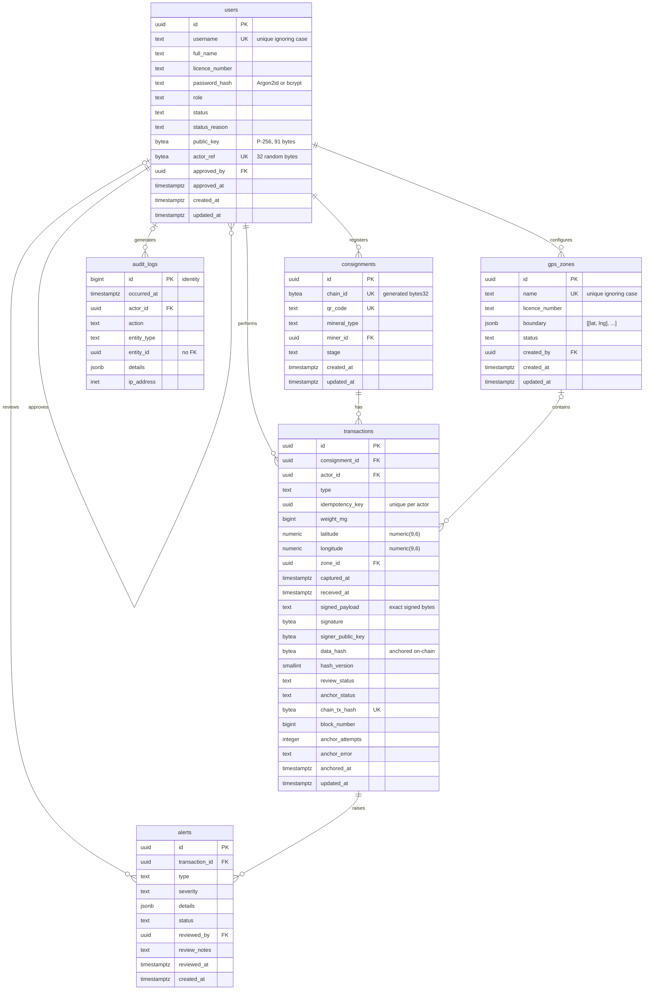

# Database schema

The server database is PostgreSQL. It holds the full signed records behind the compact
entries anchored on Sepolia, together with accounts, extraction zones, alerts and the audit
log. Development uses PostgreSQL 18 locally, and the hosted database will run on Render
(planned).

Every schema change is a plain SQL migration in `backend/migrations/`, applied with
node-pg-migrate 9. There is one migration per table, in dependency order. The reasons
behind the design are recorded in [decisions.md](decisions.md).

## Tables

| Table | Holds | Requirements |
|---|---|---|
| `users` | Accounts for the five roles: password hash, P-256 public key, random on-chain actor reference, approval | FR-06, FR-10, FR-12 |
| `gps_zones` | Licensed extraction zones, stored as polygons | FR-08, FR-11 |
| `consignments` | Identity, mineral, miner and current stage of each consignment | FR-01 |
| `transactions` | One row per signed custody step: signature, anchored hash, review and anchoring state | FR-02, FR-03, FR-05, FR-07 |
| `alerts` | One row per failed anomaly check, plus the officer's review | FR-08 |
| `audit_logs` | Append-only record of every action | FR-05, FR-13 |

## Entity relationship diagram

The diagram shows what PostgreSQL enforces. In the database a consignment can have zero
transactions. In practice the service creates a consignment and its registration step in
one database transaction, so every consignment has at least one step.

## Conventions

- **Primary keys** are `uuid` values from `gen_random_uuid()`, except in `audit_logs`.
  Phones can create UUIDs offline without clashing, and they cannot be guessed.
- **Times** are `timestamptz`, stored in UTC.
- **Fixed lists** use `CHECK (col IN (...))` rather than `ENUM`, so a value can be added or
  removed with one small migration.
- **Hashes and keys** are `bytea` with a length check.
- **Foreign keys** use `ON DELETE RESTRICT`. Deleting a row that something still refers to
  fails with error `23001`, so a user with any history is suspended, not deleted.
- **Every constraint has a name.** PostgreSQL reports it as `err.constraint`, so tests, and
  later the API, can tell exactly which rule a row broke.
- **`updated_at`** is kept current by the shared `set_updated_at()` trigger on `users`,
  `gps_zones`, `consignments` and `transactions`.
- **Large and exact numbers arrive as strings.** `pg` returns `bigint` (weights, block
  numbers, audit IDs) and `numeric` (coordinates) as strings, so no precision is lost on
  the way to JavaScript.

## Rules by table

### users
- `username`: 3–32 characters from `A–Z a–z 0–9 _ . -`, unique ignoring case.
- `password_hash`: must be an Argon2id or bcrypt hash string. A plain password is refused.
- `role`: `miner`, `transporter`, `buyer`, `officer` or `admin`.
- `status`: `pending` (the default), `active`, `suspended` or `rejected`. Suspended and
  rejected accounts need a non-blank `status_reason`.
- `public_key`: NULL, or a 91-byte P-256 key as exported by the Android Keystore. Unique
  across accounts through the index `users_public_key_key` (migration
  `users-public-key-unique`), so one device key belongs to one account. NULLs never clash,
  so any number of accounts can have no key. Set once by the user; cleared only by an
  administrator's key reset on a suspended account (see [signing-spec.md](signing-spec.md),
  section 2).
- `actor_ref`: 32 random bytes, unique, used as the on-chain actor reference. It is made
  with `crypto.randomBytes`, never derived from personal data.
- `approved_by` and `approved_at` are set together. Nobody can approve their own account.

### gps_zones
- `name`: unique ignoring case.
- `status`: `active` or `inactive`. Zones are deactivated, never deleted.
- `boundary`: a JSON array of at least 3 corners. Each corner is a `[lat, lng]` pair of
  numbers within ±90 and ±180, checked with a strict jsonpath expression. The order is
  `[lat, lng]`, the reverse of GeoJSON's `[lng, lat]`.

### consignments
- `chain_id`: a generated column: 16 zero bytes followed by the 16 bytes of `id`. It is the
  contract's `bytes32` id and cannot be written by hand.
- `qr_code`: unique, 4–128 characters from `A–Z a–z 0–9 . _ : / -`.
- `mineral_type`: `gold`, `copper`, `cobalt`, `manganese`, `emerald` or `amethyst`.
- `stage`: `registered`, `in_transit` or `purchased`. This is a stored copy, kept in step
  with `transactions` (see decisions).
- Weight, GPS, capture time and hash are not stored here. They belong to the signed
  registration step. A consignment is **held** while any alert on its steps is open.

### transactions
- `type`: `registration`, `handoff` or `purchase`.
- `idempotency_key`: made by the phone and included in the signed record. It is unique per
  actor, so a retried sync cannot create a second row (see below).
- `weight_mg` > 0. `latitude` and `longitude` are `numeric(9,6)` within ±90 and ±180.
  `zone_id` is the matched zone, or NULL when the point was outside every zone.
- **Evidence:**
  - `signed_payload` is the exact text the phone signed;
  - `signature` is 8–72 bytes (DER);
  - `signer_public_key` is 91 bytes;
  - `data_hash` is 32 bytes;
  - `hash_version` is 1 or higher.
  - The payload format, signature encoding and `data_hash` scheme are defined in
    [signing-spec.md](signing-spec.md).
- `review_status`: `passed`, `flagged`, `cleared` or `rejected`.
- `anchor_status`: `pending`, `submitted`, `confirmed` or `failed`.
  - `submitted` and `confirmed` need a `chain_tx_hash`.
  - `confirmed` also needs `block_number` and `anchored_at`.
  - `failed` needs a non-blank `anchor_error`.
  - Only `passed` or `cleared` steps can move past `pending`.
- `chain_tx_hash`: 32 bytes and unique. One Sepolia transaction anchors one step.
- **Partial unique indexes:** at most one accepted (`passed` or `cleared`) registration and
  one accepted purchase per consignment. Flagged and rejected duplicates are kept as
  evidence. Handoffs are not limited.
- **Indexes:**
  - custody chain: `(consignment_id, received_at)`;
  - FR-09 report filters: `(actor_id, received_at)`, `(zone_id, captured_at)` and
    `(captured_at)`;
  - verification: `(data_hash)`;
  - the anchoring queue: `(received_at)`, limited to approved steps that are pending or
    submitted.

### alerts
- `type`: `duplicate_consignment`, `quantity_discrepancy`, `gps_zone`, `invalid_signature`,
  `handoff_order` or `record_tampered`.
- `severity`: `low`, `medium` or `high`.
- `status`: `open`, `reviewed` or `dismissed`.
  - An open alert has no review fields.
  - A reviewed or dismissed alert has `reviewed_by`, `reviewed_at` and non-blank
    `review_notes`.
- `details`: must be a JSON object.
- One alert per rule per step: `UNIQUE (transaction_id, type)`.
- A partial index on `created_at` covers open alerts only, for the officer's queue.

### audit_logs
- `id`: a `bigint` identity, assigned in insert order. Gaps are normal, because a
  rolled-back insert still uses up a number, so a gap is not evidence of a deleted row.
- `action`: `area.verb`, for example `user.login` or `alert.dismiss`.
- `entity_type` (`user`, `gps_zone`, `consignment`, `transaction` or `alert`) and
  `entity_id` are given together or not at all. There is no foreign key, so a log entry
  outlives what it describes.
- `ip_address`: `inet`, a valid IPv4 or IPv6 address. `details` must be a JSON object.
- Append-only (see below).

## Offline sync and duplicate steps

Steps arrive in batches through `POST /sync/steps` (see `docs/api.md`). Each step is handled
in its own database transaction, in the order sent, and gets one of five outcomes:

| Outcome | Stored? | When |
|---|---|---|
| `created` | yes | Stored with `review_status = 'passed'` |
| `duplicate` | already | The same step was stored before; nothing is written |
| `flagged` | yes | Stored with `review_status = 'flagged'` and an open alert, which holds the consignment |
| `rejected` | no | It can never be accepted as it is (a malformed record, the wrong account or role, a reused step id) |
| `deferred` | not yet | Something it depends on has not arrived. The app resends it unchanged later |

**Retries.** Each signed record carries its own `idempotency_key`. Before any consignment
rule, the server looks it up for this actor:

- the same `data_hash` means a genuine retry: the result is `duplicate`, with the existing
  step;
- a different hash means the key was reused for different data: the result is `rejected`
  with `STEP_ID_CONFLICT`.

The insert itself uses
`ON CONFLICT ON CONSTRAINT transactions_idempotency_key_unique DO NOTHING`, so if two
copies of one step arrive at the same moment, only one row is written and the other copy
is compared the same way.

**Deferred steps.** `transactions.consignment_id` is `NOT NULL`, so a handoff or purchase
whose consignment has not reached the server yet cannot be stored. It is `deferred`
(`CONSIGNMENT_NOT_FOUND`), and so is a purchase while the consignment is still `registered`
(`STAGE_NOT_READY`). Nothing is written; the step is accepted unchanged once the earlier step
arrives.

**Stages.** A registration creates the consignment for its QR code. Handoffs and purchases
lock the consignment row with `SELECT … FOR UPDATE`, so two steps for one consignment are
decided one after the other. **The stage moves only for `passed` steps:** a handoff moves it
to `in_transit` (another handoff at `in_transit` is a relay and leaves it there), and a
purchase moves it to `purchased`, which is final. A flagged step is stored but leaves the
stage where it was; a step on a consignment that is already held is stored normally, and the
anchoring worker skips held consignments.

**Values.** Weight, coordinates and capture time are stored from the signed text, with no
floating-point step. `received_at` is always set by the database, as `clock_timestamp()` at the
insert rather than the column default `now()` (the transaction's start), so that within a
consignment it follows custody order (decisions log, 9 Nov). `zone_id` is NULL until
the GPS zone check is built.

One row means one anchoring job. If the server stops after sending to Sepolia, the row
stays `submitted` with its `chain_tx_hash`, and the anchoring worker checks that hash
on-chain before sending again. Together these cover the contract's non-idempotent
`recordHandoff`.

## Rules enforced by the service, not the database

A CHECK constraint can only see its own row, so these rules live in the backend services:

- the actor's role matches the step type (miner registers, transporter hands off, buyer
  purchases);
- steps follow the stage order. The service locks the consignment row with
  `SELECT … FOR UPDATE` and updates `consignments.stage` in the same database transaction
  as the step;
- the 10% quantity discrepancy check;
- the GPS point lies inside `zone_id`, and the zone is active;
- the P-256 signature verifies against `signer_public_key`;
- `latitude` and `longitude` have at most 6 decimal places. The API rejects more, rather
  than letting `numeric(9,6)` round them, and the app rounds to 6 places before signing;
- the reviewer is an officer, severity follows from the alert type, and an alert never
  returns to `open`;
- closing an alert updates the step in the same database transaction: `reviewed` makes
  the step `rejected`, and `dismissed` makes it `cleared`;
- audit `details` never contain passwords, tokens or keys.

## Append-only audit log

Two statement-level triggers call `audit_logs_reject_change()`, which raises error `P0001`
(`audit_logs is append-only: <operation> is not allowed`):

- `BEFORE UPDATE OR DELETE … FOR EACH STATEMENT` refuses any `UPDATE` or `DELETE`, even
  one whose `WHERE` matches no rows;
- `BEFORE TRUNCATE … FOR EACH STATEMENT` is needed separately, because `TRUNCATE` empties a
  table without firing `DELETE` triggers.

`INSERT` and `SELECT` are unaffected. A mistake is corrected by adding a new entry that
refers to the old one.

**Limit.** The triggers protect the log from the application, not from someone with full
database access. One database user currently runs both the migrations and the app, so it
owns the table and could disable the triggers (`ALTER TABLE … DISABLE TRIGGER`), drop the
table, or restore an altered backup. A test records this limit openly.

Planned hardening:

- run migrations as a separate owner role, and give the app's role only `INSERT` and
  `SELECT` on `audit_logs`;
- make changes detectable by chaining a hash through the log entries, or by anchoring a
  periodic hash of the log on Sepolia.

## Running migrations

From `backend/`:

| Command | Effect |
|---|---|
| `npm run migrate` | Applies pending migrations to the development database (`DATABASE_URL`) |
| `npm run migrate:test` | The same, for the test database (`TEST_DATABASE_URL`) |
| `npm run migrate:down` | Rolls back the latest migration on the development database. Add `-- 2` for two |
| `npm run migrate:create -- <name>` | Creates `migrations/<timestamp>_<name>.sql` with up and down sections |

Pending migrations run in one transaction, under an advisory lock, and only in order.
Once a migration has been committed, it is never edited; a change is a new migration. On
Render, `npm run migrate` is planned to run before `npm start` on each deploy.

## Database tests

`npm run test:db` runs the tests in `backend/tests/db/` against the test database. The
migrations are applied automatically first, and each test runs inside a transaction that
is rolled back afterwards, so no test leaves data behind. `npm test` excludes these tests
and needs no database.

Every rule has tests that a valid row is accepted and an invalid one rejected. Each reject
test checks the PostgreSQL error code and the name of the constraint that fired, so it
cannot pass because some other rule rejected the row.
