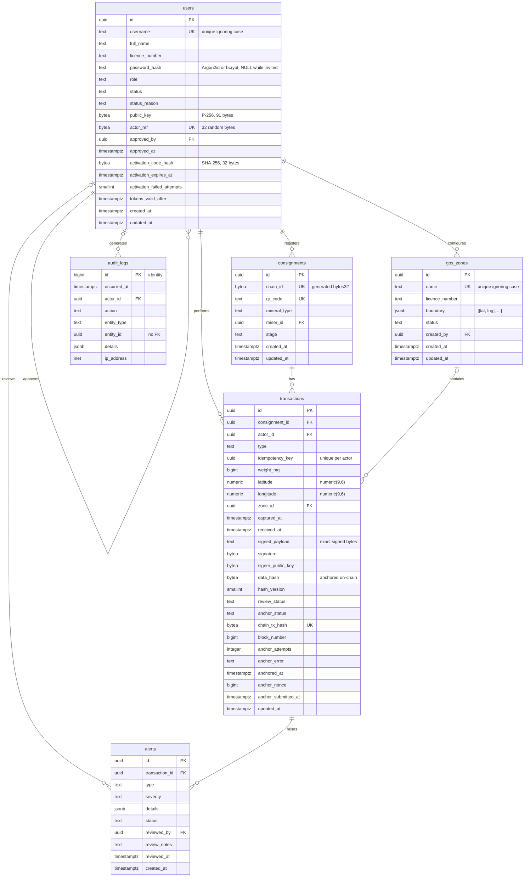

# Database schema

The server database is PostgreSQL. It holds the full signed records behind the compact
entries anchored on Sepolia, together with accounts, extraction zones, alerts and the audit
log. Development uses PostgreSQL 18 locally, and the hosted database will run on Render
(planned).

Every schema change is a plain SQL migration in `backend/migrations/`, applied with
node-pg-migrate 9. There is one migration per table, in dependency order. The reasons
behind the design are recorded in [decisions.md](decisions.md).

## Tables

| Table | Holds | Requirements |
|---|---|---|
| `users` | Accounts for the five roles: password hash, P-256 public key, random on-chain actor reference, approval, activation code hash, password-change cut-off | FR-06, FR-10, FR-12 |
| `gps_zones` | Licensed extraction zones, stored as polygons | FR-08, FR-11 |
| `consignments` | Identity, mineral, miner and current stage of each consignment | FR-01 |
| `transactions` | One row per signed custody step: signature, anchored hash, review and anchoring state | FR-02, FR-03, FR-05, FR-07 |
| `alerts` | One row per failed anomaly check, plus the officer's review | FR-08 |
| `audit_logs` | Append-only record of every action | FR-05, FR-13 |

## Entity relationship diagram



The diagram shows what PostgreSQL enforces. In the database a consignment can have zero
transactions. In practice the service creates a consignment and its registration step in
one database transaction, so every consignment has at least one step.

## Conventions

- **Primary keys** are `uuid` values from `gen_random_uuid()`, except in `audit_logs`.
  Phones can create UUIDs offline without clashing, and they cannot be guessed.
- **Times** are `timestamptz`, stored in UTC.
- **Two clocks.** `now()` is the time the database transaction *started*, and stays the same
  for every statement in it; `clock_timestamp()` is the time of the statement itself. Where
  two times in one transaction are ordered against each other, the later one must use
  `clock_timestamp()`, or it can come out earlier than something written before it.
  - `transactions.received_at` and `alerts.created_at` default to `clock_timestamp()`
    (migration `1794398400000_clock-timestamp-defaults`), and sync also writes
    `clock_timestamp()` explicitly for both. See [Anchoring](#anchoring) for why
    `received_at` must follow custody order; an alert is inserted after its step, so its
    `created_at` is never earlier than the step's `received_at`.
  - Every other default (`created_at`, `updated_at` through `set_updated_at()`,
    `audit_logs.occurred_at`) is `now()`, and nothing orders them against another time in
    the same transaction. A read-only check of every `now()` found them safe (decisions log,
    11 Nov). Three to watch:
    - `audit_logs.occurred_at` is `now()`, so an entry such as `transaction.create` is earlier
      than the step it records; if audit entries are ever merged into a trail by time, they
      would sort before their step.
    - `alerts.reviewed_at` should be written with `clock_timestamp()` when officer review is
      built.
    - `consignments.created_at` is not a display time for "registered at": it is slightly
      earlier than the registration step; use the registration's `received_at`.
  - `users.activation_expires_at` is written as `clock_timestamp() + 72 hours` and checked
    against `clock_timestamp()`, so the database's clock both sets and judges it.
  - `users.tokens_valid_after` is the one time that comes from the **app server's** clock:
    it is the issue time (`iat`) of the token a password change returns, compared with the
    `iat` of every later token, which the same server writes. Comparing it with a database
    time would mix two clocks (decisions log, Accounts).
- **Fixed lists** use `CHECK (col IN (...))` rather than `ENUM`, so a value can be added or
  removed with one small migration.
- **Hashes and keys** are `bytea` with a length check.
- **Foreign keys** use `ON DELETE RESTRICT`. Deleting a row that something still refers to
  fails with error `23001`, so a user with any history is suspended, not deleted.
- **Every constraint has a name.** PostgreSQL reports it as `err.constraint`, so tests, and
  later the API, can tell exactly which rule a row broke.
- **`updated_at`** is kept current by the shared `set_updated_at()` trigger on `users`,
  `gps_zones`, `consignments` and `transactions`.
- **Large and exact numbers arrive as strings.** `pg` returns `bigint` (weights, block
  numbers, audit IDs) and `numeric` (coordinates) as strings, so no precision is lost on
  the way to JavaScript.

## Rules by table

### users
- `username`: 3–32 characters from `A–Z a–z 0–9 _ . -`, unique ignoring case. The index
  covers every status, so the username of an invited, pending or rejected account stays
  taken.
- `password_hash`: an Argon2id or bcrypt hash string, or NULL (`users_password_is_hash`).
  A plain password is refused.
- `role`: `miner`, `transporter`, `buyer`, `officer` or `admin`.
- `status`: `pending` (the default), `active`, `suspended`, `rejected` or `invited`
  (`users_status_valid`). Suspended and rejected accounts need a non-blank `status_reason`.
  - `pending`: a miner, transporter or buyer asked for an account and waits for approval.
  - `invited`: an administrator created this officer or administrator account (FR-10), and
    its owner has not activated it yet. It cannot log in, every admin action except a new
    code refuses it, and it is never counted as an active administrator.
  - `active`, `suspended`, `rejected`: as before; `rejected` is final.
- **Invited accounts and their activation codes** (migration `1794441600000_users-activation`):
  - `users_password_only_when_invited`: `(password_hash IS NULL) = (status = 'invited')`.
    Both directions in one rule: an invited account has **no** password hash at all, rather
    than a made-up one (NULL says honestly "no password yet", and no login can ever match
    it), and every other account always has one. Activation must therefore set the hash and the status in
    the same `UPDATE`.
  - `activation_code_hash`: the SHA-256 of the current activation code, or NULL when there
    is none (never issued, used, or erased after 5 wrong attempts). The code itself is never
    stored. `users_activation_code_32_bytes`: a SHA-256 digest is always 32 bytes, so any
    other length is a bug.
  - `activation_expires_at`: when that code stops working. `users_activation_complete`:
    `(activation_code_hash IS NULL) = (activation_expires_at IS NULL)`, so there is never a
    code that never expires, nor an expiry with nothing to expire. The code and its expiry
    are set together and cleared together.
  - `users_activation_only_when_invited`: a code exists only while the account is
    `invited`. Once it is active, a leftover code is impossible, not merely unused. An
    invited account may have no code (after the erase), until an administrator issues a new
    one.
  - `activation_failed_attempts` (`smallint`, default 0): wrong codes tried against the
    current code. `users_activation_attempts_non_negative`: at least 0. Reset to 0 by a new
    code and by activation. The limit of 5 is the service's.
- `tokens_valid_after`: the password-change cut-off. A token issued (`iat`) before this
  moment is refused; NULL, the value of every account until its first password change,
  means no cut-off. Set by `POST /auth/me/password` to the fresh token's own issue time, as
  `to_timestamp(<iat>)`, in the same `UPDATE` as the new hash.
- **Rolling back** `1794441600000_users-activation` stops with an error while any invited
  account exists: it has no password hash, which the old schema requires. Activate those
  accounts, or remove them if they have no history, first.
- `public_key`: NULL, or a 91-byte P-256 key as exported by the Android Keystore. Unique
  across accounts through the index `users_public_key_key` (migration
  `users-public-key-unique`), so one device key belongs to one account. NULLs never clash,
  so any number of accounts can have no key. Set once by the user; cleared only by an
  administrator's key reset on a suspended account (see [signing-spec.md](signing-spec.md),
  section 2).
- `actor_ref`: 32 random bytes, unique, used as the on-chain actor reference. It is made
  with `crypto.randomBytes`, never derived from personal data.
- `approved_by` and `approved_at` are set together. Nobody can approve their own account.

### gps_zones
- `name`: unique ignoring case, through the index `gps_zones_name_lower_key` on
  `lower(name)`. It covers active **and** inactive zones, so a name stays taken after its
  zone is deactivated. A replacement zone gets the old name only after the old zone is
  renamed (see [api.md, Replacing a zone](api.md#replacing-a-zone)).
- `status`: `active` or `inactive`. Zones are deactivated, never deleted:
  `transactions.zone_id` refers to them (`ON DELETE RESTRICT`).
- `boundary`: a JSON array of at least 3 corners. Each corner is a `[lat, lng]` pair of
  numbers within ±90 and ±180, checked with a strict jsonpath expression. The order is
  `[lat, lng]`, the reverse of GeoJSON's `[lng, lat]`.
- **`boundary` and `licence_number` are fixed once the zone is created.** Every
  `transactions.zone_id` must keep meaning the shape that was checked when the step
  arrived, so a new shape is a new zone. The zone service has no statement that updates
  either column (a test reads its `UPDATE` statements to keep it so), and no API route
  changes them. The database does not enforce this: there is no trigger, so a direct SQL
  `UPDATE` could still change them (a known limitation in decisions).
- **Shape rules.** Every boundary written through the API or the seed passes
  `zoneBoundarySchema` (`backend/src/schemas/geo.js`) first. On top of the database checks,
  it requires at most 100 corners and at most 6 decimal places, and then the shape rules in
  `backend/src/services/zoneShape.js`: no corner repeating the one before it, no closing
  corner (the last repeating the first), at least 3 different corners, every corner inside
  a rough box around Zambia, an area of at least 100 m², and at most 50 km from north to
  south and from east to west. The seed uses the same schema, so the seeded demo zone obeys
  the same rules. The full list, with messages, is in
  [api.md, The boundary](api.md#the-boundary).
- **Sync reads the active zones on every call**, with no cache. A zone created,
  deactivated or reactivated applies from the next sync. Steps already stored keep their
  `zone_id`, and nothing is checked again.

### consignments
- `chain_id`: a generated column: 16 zero bytes followed by the 16 bytes of `id`. It is the
  contract's `bytes32` id and cannot be written by hand.
- `qr_code`: unique, 4–128 characters from `A–Z a–z 0–9 . _ : / -`.
- `mineral_type`: `gold`, `copper`, `cobalt`, `manganese`, `emerald` or `amethyst`.
- `stage`: `registered`, `in_transit` or `purchased`. This is a stored copy, kept in step
  with `transactions` (see decisions).
- Weight, GPS, capture time and hash are not stored here. They belong to the signed
  registration step. A consignment is **held** while any alert on its steps is open, with
  one exception (see [Held consignments](#held-consignments)).

### transactions
- `type`: `registration`, `handoff` or `purchase`.
- `idempotency_key`: made by the phone and included in the signed record. It is unique per
  actor, so a retried sync cannot create a second row (see below).
- `weight_mg` > 0. `latitude` and `longitude` are `numeric(9,6)` within ±90 and ±180.
  `zone_id` is set by sync for **every** step, whatever its type: the active zone the point
  falls in, counting points within 25 m of a zone's edge as inside. NULL means the point
  was outside every active zone. Only a registration is flagged for that (`gps_zone`);
  handoffs and purchases happen on the road and at buying centres, so their `zone_id` is
  recorded for reports only. When the point is in or near more than one zone, the choice is
  fixed: inside before near, then nearer, then by name, then by id.
- **Evidence:**
  - `signed_payload` is the exact text the phone signed;
  - `signature` is 8–72 bytes (DER);
  - `signer_public_key` is 91 bytes;
  - `data_hash` is 32 bytes;
  - `hash_version` is 1 or higher.
  - The payload format, signature encoding and `data_hash` scheme are defined in
    [signing-spec.md](signing-spec.md).
- `review_status`: `passed`, `flagged`, `cleared` or `rejected`.
- `anchor_status`: `pending`, `submitted`, `confirmed` or `failed`.
  - `submitted` and `confirmed` need a `chain_tx_hash`.
  - `confirmed` also needs `block_number` and `anchored_at`.
  - `failed` needs a non-blank `anchor_error`.
  - `submitted` also needs `anchor_nonce` and `anchor_submitted_at`, and `anchor_nonce` is
    0 or more.
  - Only `passed` or `cleared` steps can move past `pending`.
  - See [Anchoring](#anchoring) for what each state means and how a step moves between them.
- `chain_tx_hash`: 32 bytes and unique. One Sepolia transaction anchors one step.
- **Partial unique indexes:** at most one accepted (`passed` or `cleared`) registration and
  one accepted purchase per consignment. Flagged and rejected duplicates are kept as
  evidence. Handoffs are not limited.
- **Indexes:**
  - custody chain: `(consignment_id, received_at)`;
  - FR-09 report filters: `(actor_id, received_at)`, `(zone_id, captured_at)` and
    `(captured_at)`;
  - verification: `(data_hash)`;
  - the anchoring queue: `(received_at)`, limited to approved steps that are pending or
    submitted.

### alerts
- `type`: `duplicate_consignment`, `quantity_discrepancy`, `gps_zone`, `invalid_signature`,
  `handoff_order` or `record_tampered`.
- `severity`: `low`, `medium` or `high`.
- `status`: `open`, `reviewed` or `dismissed`.
  - An open alert has no review fields.
  - A reviewed or dismissed alert has `reviewed_by`, `reviewed_at` and non-blank
    `review_notes`.
- `details`: must be a JSON object. Its shape depends on the type (below).
- One alert per rule per step: `UNIQUE (transaction_id, type)`.
- A partial index on `created_at` covers open alerts only, for the officer's queue.
- `created_at` is `clock_timestamp()`, written by sync and also the column default since
  11 Nov. An alert is inserted after its step in the same transaction, so it is never
  earlier than the step's `received_at`, and the audit trail lists it after the step. Alerts
  stored before 11 Nov carry their transaction's start time and can sort before their step
  (a known limitation; development data only).

**`details` per alert type.** Written by the anomaly checks in
`backend/src/services/anomalyChecks.js`. Weights are whole milligrams as text, never JSON
numbers. Details hold ids, never names of people. All values in the examples are fake.

- `invalid_signature` (high): the SHA-256 fingerprint of the registered key the signature
  was checked against, never the key itself.

  ```json
  { "keyFingerprint": "3b1f0c9e3b1f0c9e3b1f0c9e3b1f0c9e3b1f0c9e3b1f0c9e3b1f0c9e3b1f0c9e" }
  ```

- `duplicate_consignment` (high): the consignment's original registration (the accepted one
  if there is one, otherwise the earliest), whether the same miner registered both, and both
  minerals.

  ```json
  { "originalTransactionId": "7a3e9b10-0000-4000-8000-000000000001",
    "originalReviewStatus": "passed", "sameMiner": false,
    "mineral": "gold", "originalMineral": "gold" }
  ```

- `handoff_order` (high for a purchase, medium for a handoff): a step after the consignment
  was purchased.

  ```json
  { "consignmentStage": "purchased", "stepType": "handoff" }
  ```

- `quantity_discrepancy` (medium): the step's weight, the threshold, and each baseline it was
  compared with. `previous` (the latest earlier accepted step) is present only when that
  step is not the registration; `registration` (the accepted registration) is present when
  there is one. `differenceMg` is the step's weight minus the baseline's: negative is a loss.
  `failedBaselines` names those over the threshold. Here a handoff gained weight and the
  purchase then lost it: within 10% of the registration, but not of the handoff.

  ```json
  { "weightMg": "1460000", "thresholdPercent": 10, "failedBaselines": ["previous"],
    "previous": { "stepId": "7a3e9b10-0000-4000-8000-000000000002", "weightMg": "1640000",
                  "differenceMg": "-180000", "exceeded": true },
    "registration": { "stepId": "7a3e9b10-0000-4000-8000-000000000001", "weightMg": "1500000",
                      "differenceMg": "-40000", "exceeded": false } }
  ```

- `gps_zone` (medium, registrations only): the nearest active zone and the distance to its
  edge in whole metres, with the tolerance. With no active zone at all, the details say so
  instead.

  ```json
  { "nearestZoneId": "5c0d7e21-0000-4000-8000-000000000001",
    "nearestZoneName": "ZCAS Campus (demo)", "distanceMetres": 142, "toleranceMetres": 25 }
  ```

  ```json
  { "noActiveZones": true, "toleranceMetres": 25 }
  ```

- `record_tampered`: never raised by sync. It comes from verification, which is still to be
  built, and its details will be defined there.

**Two meanings of `stepId`.** Inside `quantity_discrepancy` details, `previous.stepId` and
`registration.stepId` are server ids, `transactions.id`. In a `POST /sync/steps` result,
`stepId` is the client's `step_id` from the signed payload, stored as
`transactions.idempotency_key`. They are different values. A rename was considered and
deferred (decisions log, 10 Nov).

### audit_logs
- `id`: a `bigint` identity, assigned in insert order. Gaps are normal, because a
  rolled-back insert still uses up a number, so a gap is not evidence of a deleted row.
- `action`: `area.verb`, for example `user.login` or `alert.dismiss`.
- `entity_type` (`user`, `gps_zone`, `consignment`, `transaction` or `alert`) and
  `entity_id` are given together or not at all. There is no foreign key, so a log entry
  outlives what it describes.
- `ip_address`: `inet`, a valid IPv4 or IPv6 address. `details` must be a JSON object.
- Append-only (see below).

## Offline sync and duplicate steps

Steps arrive in batches through `POST /sync/steps` (see `docs/api.md`). Each step is handled
in its own database transaction, in the order sent, and gets one of five outcomes:

| Outcome | Stored? | When |
|---|---|---|
| `created` | yes | Stored with `review_status = 'passed'` |
| `duplicate` | already | The same step was stored before; nothing is written |
| `flagged` | yes | Stored with `review_status = 'flagged'` and an open alert, which holds the consignment |
| `rejected` | no | It can never be accepted as it is (a malformed record, the wrong account or role, a reused step id) |
| `deferred` | not yet | Something it depends on has not arrived. The app resends it unchanged later |

**Retries.** Each signed record carries its own `idempotency_key`. Before any consignment
rule, the server looks it up for this actor:

- the same `data_hash` means a genuine retry: the result is `duplicate`, with the existing
  step;
- a different hash means the key was reused for different data: the result is `rejected`
  with `STEP_ID_CONFLICT`.

The insert itself uses
`ON CONFLICT ON CONSTRAINT transactions_idempotency_key_unique DO NOTHING`, so if two
copies of one step arrive at the same moment, only one row is written and the other copy
is compared the same way.

**Deferred steps.** `transactions.consignment_id` is `NOT NULL`, so a handoff or purchase
whose consignment has not reached the server yet cannot be stored. It is `deferred`
(`CONSIGNMENT_NOT_FOUND`), and so is a purchase while the consignment is still `registered`
(`STAGE_NOT_READY`). Nothing is written; the step is accepted unchanged once the earlier step
arrives.

**Stages.** A registration creates the consignment for its QR code. Handoffs and purchases
lock the consignment row with `SELECT … FOR UPDATE`, so two steps for one consignment are
decided one after the other. **The stage moves only for `passed` steps:** a handoff moves it
to `in_transit` (another handoff at `in_transit` is a relay and leaves it there), and a
purchase moves it to `purchased`, which is final. A flagged step is stored but leaves the
stage where it was; a step on a consignment that is already held is stored normally, and the
anchoring worker skips held consignments.

**Values.** Weight, coordinates and capture time are stored from the signed text, with no
floating-point step. `received_at` is always set by the database, as `clock_timestamp()` at the
insert rather than `now()` (the transaction's start), so that within a consignment it follows
custody order (decisions log, 9 Nov). Since 11 Nov the column default is `clock_timestamp()`
too, so an insert that leaves it out gets the same. `zone_id` is worked out by the
server from the signed coordinates (see [transactions](#transactions)).

One row means one anchoring job: see [Anchoring](#anchoring).

## Anchoring

The anchoring worker writes each accepted step to the MineChain contract on Sepolia
(`backend/src/services/anchorService.js`). It runs on a timer inside the API when
`ANCHOR_ENABLED=true`, or one tick at a time through the `anchor:once` script. All of its
state is kept on the step's own `transactions` row; there is no separate job table.

### States

| `anchor_status` | Meaning | Columns set |
|---|---|---|
| `pending` | Not on-chain yet; may be sent when the queue rules allow | `anchor_error` may hold the last refusal |
| `submitted` | Signed and sent (or about to be); waiting to be mined and confirmed | `chain_tx_hash`, `anchor_nonce`, `anchor_submitted_at` |
| `confirmed` | Mined, with enough confirmations, and its event matches the step | `chain_tx_hash`, `block_number`, `anchored_at` |
| `failed` | Will not be sent again without a person (a manual reset is future work) | `anchor_error` |

How a step moves:

- **`pending` → `submitted`.** The transaction is signed locally first, so its hash and the
  wallet nonce are known. They are saved, with `anchor_submitted_at` and one more
  `anchor_attempts`, **before** the broadcast. After a crash the worker therefore always
  knows what it may have sent.
- **`submitted` → `confirmed`.** The receipt is found, has at least `ANCHOR_CONFIRMATIONS`
  confirmations, and contains the matching event. `anchored_at` is the block's timestamp,
  not the server's clock. If the step turns out to be on-chain through another transaction
  (found through the logs), that transaction's hash replaces the stored one.
- **`submitted` stays `submitted`.** When no receipt has appeared after a two-minute grace
  period, the worker first reads the contract's record for the consignment. If the step is
  not there and the nonce is still unused, the transaction was dropped or never broadcast,
  so it is signed again with the **same nonce** and sent again. Two copies with one nonce can
  never both be mined, so a handoff can never be anchored twice. A row whose nonce is unused
  is never marked failed.
- **`submitted` → `pending`.** Only when the transaction can never be mined: another
  transaction used its nonce, it was mined but reverted, or the node refused the broadcast
  outright (funds, fee, nonce). `chain_tx_hash`, `anchor_nonce` and `anchor_submitted_at`
  are cleared.
- **`pending` → `failed`.** The contract would refuse the step (`InvalidInput`, a wrong
  stage, an id already registered with another hash, or stored data it cannot accept), or
  a retryable refusal has used up `ANCHOR_MAX_ATTEMPTS`.
- **`submitted` → `failed`.** A mined revert on the last attempt, or a receipt whose event
  does not match the step. The hash is kept as evidence.
- **`pending` → `confirmed`.** A registration refused with `ConsignmentAlreadyExists` whose
  on-chain event matches the step: an earlier send succeeded without being recorded.

### Columns

- `anchor_nonce` (`bigint`, returned as text): the recorder wallet's nonce for the step's
  transaction. Without it, a resend would need a new nonce, and both copies could be mined.
- `anchor_submitted_at`: when the row became `submitted`, by the server's clock. Used only
  for the grace period, and never compared with `anchored_at`, which comes from another
  clock.
- Both stay set after `confirmed` and `failed`, as a record of how the step was sent, and are
  cleared only when the row goes back to `pending`.
- `anchor_attempts`: counts tries that are the step's own fault. It goes up at each send and
  each retryable refusal, and is given back when the cause was not the step (the wallet's
  funds, the fee, a nonce taken by someone else). Same-nonce resends and RPC outages never
  count.
- `anchor_error`: our own code and a fixed reason only, for example
  `INVALID_STAGE:None: the step is not allowed from the consignment stage on-chain`. Never
  text from the RPC provider, whose messages can contain the API key.

### Which step goes next

Each tick first reconciles every `submitted` row, in nonce order, which is the order the
chain mines them in. Holds are ignored there: a sent transaction may be mined whatever an
alert says now. A new step is sent only when nothing is in flight, so there is **at most one
anchoring transaction at a time**.

The next step is the oldest row, by `(received_at, id)`, that meets all of these:

- `anchor_status = 'pending'` and `review_status` is `passed` or `cleared`. The query repeats
  the condition of `transactions_anchor_queue_idx` so PostgreSQL can use it;
- its consignment is **not held** (see [Held consignments](#held-consignments));
- **no earlier step** of the same consignment, by `(received_at, id)`, is `passed`, `cleared`
  or `flagged` and not yet `confirmed`. Rejected steps are ignored, a failed one blocks
  everything after it, and a flagged one blocks because it may still be cleared;
- a handoff or purchase also needs the consignment's accepted registration to be
  `confirmed`.

The row is read with `FOR UPDATE OF t SKIP LOCKED`, and read again inside the short database
transaction that marks it `submitted`, so a hold that arrives while the worker is on the
network still stops it. No database transaction is held open across a network call.

**`received_at` follows custody order.** Sync sets it with `clock_timestamp()` at the insert,
not the column default `now()`, which is when the transaction started. Within one
consignment, a handoff is inserted only after its transaction has seen the registration's
committed consignment, and a purchase only after taking the consignment lock the handoff
held until it committed, so insert times follow custody order. With `now()`, a handoff could
get the earlier time, and the queue would wait for ever or send the purchase first
(decisions log, 9 Nov). The column default was changed from `now()` to `clock_timestamp()`
on 11 Nov (migration `1794398400000_clock-timestamp-defaults`), so a future insert path that
leaves it out cannot bring the problem back.

### Held consignments

Any open alert on any step of a consignment holds the **whole** consignment from anchoring,
including a registration that has not been anchored yet. The only exception is alerts on a
flagged duplicate of an accepted registration: a flagged registration on a consignment that
has a different, accepted registration. All of that duplicate's alerts are excused, not
only `duplicate_consignment`, and the duplicate does not block the ordering rule either.
Otherwise anyone with an approved account who had seen a QR code could freeze another
miner's consignment by registering it again.

Held is worked out by a query, never stored (D3), so closing the last open alert releases
the hold. The rule is written once, as `HELD` in `backend/src/services/anchorQueue.js`, and
`isConsignmentHeld()` there uses the same SQL as the queue. A held consignment still accepts
new steps, which are checked and stored normally; they simply wait to be anchored.

### One worker at a time

A tick starts by taking a session advisory lock, `pg_try_advisory_lock(5567365368752131922)`
(the bytes of "MCANCHOR"), on a connection of its own. A second process, such as
`anchor:once` while the server's worker runs, gets "busy" and does nothing. The lock ends
with its connection, so a crashed worker can never leave it held.

Known limitations of anchoring (a stuck row blocks the queue, the one-in-flight throughput,
Render's spin-down) are listed in [decisions.md](decisions.md).

## Reports

The CSV reports (FR-09, FR-13; columns and rules in [api.md](api.md#reports-fr-09-fr-13))
read these tables through fixed queries in `backend/src/services/reportService.js`:

- **Transactions report:** one row per step, joined to its consignment, its actor and its
  zone, filtered on `captured_at` in a UTC day range and ordered by
  `(captured_at, received_at, id)`. Capture times can be equal (phone clocks set by hand,
  two steps in the same millisecond); `received_at` then decides, because it follows custody
  order (see [Anchoring](#anchoring)); `id` is the last resort, so the order never varies.
  The filters use the FR-09 indexes on [transactions](#transactions).
- **Audit trail:** events built from `transactions` (recorded, anchored), `alerts` (raised,
  closed) and, for an actor, `audit_logs` entries about that user, ordered by event time,
  then a fixed event order, then ids.
- **Never selected:** `password_hash`, `public_key`, `signer_public_key`, `signature`,
  `signed_payload`, `actor_ref`, `full_name`, `ip_address`, `anchor_error`, `anchor_nonce`
  and `anchor_attempts`. Each query lists its columns, so a column added later cannot appear
  in a report by accident.
- **One snapshot:** each export reads its rows and writes its `audit_logs` entry in one
  `REPEATABLE READ` transaction (`db.transaction(fn, { isolation: 'repeatable read' })`), so
  every query sees the same moment and an export is never sent without its entry.

## Rules enforced by the service, not the database

A CHECK constraint can only see its own row, so these rules live in the backend services:

- the actor's role matches the step type (miner registers, transporter hands off, buyer
  purchases);
- steps follow the stage order. The service locks the consignment row with
  `SELECT … FOR UPDATE` and updates `consignments.stage` in the same database transaction
  as the step;
- the 10% quantity discrepancy check;
- `zone_id` is the active zone containing the point, counting points within 25 m of its
  edge as inside, or NULL if there is none; only a registration is flagged for being
  outside every active zone;
- a zone's `boundary` passes the shape rules, and its `boundary` and `licence_number` never
  change after it is created (see [gps_zones](#gps_zones));
- the P-256 signature verifies against `signer_public_key`;
- `latitude` and `longitude` have at most 6 decimal places. The API rejects more, rather
  than letting `numeric(9,6)` round them, and the app rounds to 6 places before signing;
- the reviewer is an officer, severity follows from the alert type, and an alert never
  returns to `open`;
- closing an alert updates the step in the same database transaction: `reviewed` makes
  the step `rejected`, and `dismissed` makes it `cleared`;
- audit `details` never contain passwords, tokens or keys, nor an activation code;
- only `officer` and `admin` accounts are created as `invited`, and only by an
  administrator (the role is checked by the request schema and again in the service);
- the fifth wrong activation code erases the code and its expiry, in the same `UPDATE`
  that counts it, and a guess counts only against the code that was judged;
- activation sets the password hash, `active`, and clears the code, expiry and count in
  one `UPDATE` whose `WHERE` repeats every check (still invited, the same code, not
  expired);
- a password change sets the new hash and `tokens_valid_after` in one `UPDATE` that
  matches only while the old hash is still current;
- a token is refused when its `iat` is before `tokens_valid_after`, a condition inside the
  lookup `requireAuth` runs on every request;
- a buyer's transactions report holds only accepted (`passed` or `cleared`) steps of
  consignments the buyer has an accepted purchase of, a condition inside the report query;
- every report export writes its `audit_logs` entry in the same transaction as the rows it
  sends (see [Reports](#reports)).

## Append-only audit log

Two statement-level triggers call `audit_logs_reject_change()`, which raises error `P0001`
(`audit_logs is append-only: <operation> is not allowed`):

- `BEFORE UPDATE OR DELETE … FOR EACH STATEMENT` refuses any `UPDATE` or `DELETE`, even
  one whose `WHERE` matches no rows;
- `BEFORE TRUNCATE … FOR EACH STATEMENT` is needed separately, because `TRUNCATE` empties a
  table without firing `DELETE` triggers.

`INSERT` and `SELECT` are unaffected. A mistake is corrected by adding a new entry that
refers to the old one.

**Limit.** The triggers protect the log from the application, not from someone with full
database access. One database user currently runs both the migrations and the app, so it
owns the table and could disable the triggers (`ALTER TABLE … DISABLE TRIGGER`), drop the
table, or restore an altered backup. A test records this limit openly.

Planned hardening:

- run migrations as a separate owner role, and give the app's role only `INSERT` and
  `SELECT` on `audit_logs`;
- make changes detectable by chaining a hash through the log entries, or by anchoring a
  periodic hash of the log on Sepolia.

## Running migrations

From `backend/`:

| Command | Effect |
|---|---|
| `npm run migrate` | Applies pending migrations to the development database (`DATABASE_URL`) |
| `npm run migrate:test` | The same, for the test database (`TEST_DATABASE_URL`) |
| `npm run migrate:down` | Rolls back the latest migration on the development database. Add `-- 2` for two |
| `npm run migrate:create -- <name>` | Creates `migrations/<timestamp>_<name>.sql` with up and down sections |

Pending migrations run in one transaction, under an advisory lock, and only in order.
Once a migration has been committed, it is never edited; a change is a new migration. On
Render, `npm run migrate` is planned to run before `npm start` on each deploy.

## Database tests

`npm run test:db` runs the tests in `backend/tests/db/` against the test database. The
migrations are applied automatically first, and each test runs inside a transaction that
is rolled back afterwards, so no test leaves data behind. `npm test` excludes these tests
and needs no database.

Every rule has tests that a valid row is accepted and an invalid one rejected. Each reject
test checks the PostgreSQL error code and the name of the constraint that fired, so it
cannot pass because some other rule rejected the row.
